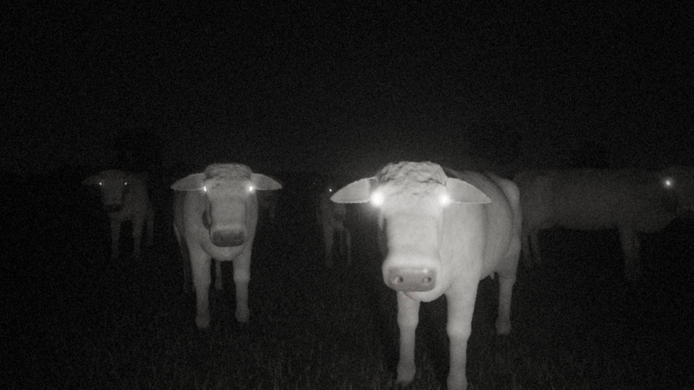

# Night Herd

1880년대 후반 애리조나 남부 소노라 사막을 배경으로 한 1인칭 3D 심리 공포 게임이에요. 소떼를 몰고 가는 카우보이가 밤마다 소를 세는데, 셀 때마다 한 마리가 남아요.



- 플랫폼: PC(Steam), 모바일, 웹
- 기술: 웹 기술(Three.js), 목표 60fps
- 그림체: 쿠와하라 필터. 소를 세는 동안에는 화면이 서서히 저해상도와 안개 번짐으로 바뀌어요.

## 페이지

| 폴더 | 내용 |
|---|---|
| `night/` | 밤 장면 1단계. 줄 선 소를 하나씩 톡 눌러 세고, 화면을 넘겨 다음 자리로 걸어가요. 랜턴은 왼손, 리볼버는 오른손. 바람에 랜턴이 꺼지면 성냥 한 개로 다시 켜요. (예전 슬라이스 셋은 2026-11-28에 뺐어요) |
| `monsters/` | 괴물 후보 페이지. 남은 후보 셋(③ 가죽이 흘러내린 것, ④ 머리가 갈라진 것, ⑤ 그림자)을 게임처럼 소 떼 사이에 세워(뒤 언덕 위에도 소가 있어요) 적외선 카메라나 랜턴 빛으로 보고, 숨쉬기·입 벌리기·경련, 총격전에서 닿았을 때 잡아먹히는 장면, 못 찾고 지나쳤을 때 점프스퀘어를 소리와 함께 봐요. `npm run bake:monsters`로 굽고 `npm run build:monsters`로 묶어요. |
| `revolvers/` | 리볼버 페이지. 게임에 쓸 콜트 피스메이커 7½″(①)와 나중에 업그레이드로 쓸 4¾″ 니켈(②), 후보였던 스코필드(③)를 돌려 보고 공이치기와 쏘기를 해 봐요. `npm run bake:revolvers`로 굽고 `npm run build:revolvers`로 묶어요. |

### 조작

- 폰: 소를 톡 = 세기, 화면을 왼쪽으로 넘기기 = 다음 자리, 왼쪽을 위로 쓸기 = 랜턴 켜기(성냥)·들기, 아래로 = 내리기·끄기, 뒤로가기 = 일시정지. 화면에 버튼은 없어요.
- PC: 마우스로 둘러보고 클릭하면 화면 가운데 소를 세요. D나 → 다음 자리, F 랜턴 끄기·켜기, 스페이스 들기, Esc 일시정지.
- 시작하면 전체화면으로 바뀌어요.

새 대화에서 이어서 작업할 때는 [HANDOFF.md](HANDOFF.md)를 먼저 읽어요.

## 플레이하기

온라인: https://kimarthur815-collab.github.io/night-herd/

첫 화면에서 슬라이스를 골라요. 폰은 가로로 돌리면 더 넓게 보여요.

## 직접 실행하기

빌드된 페이지가 저장소에 들어 있어서 바로 실행할 수 있어요. 파일을 불러와야 하니 로컬 서버로 열어야 해요.

```sh
npm install
npm run serve
```

그다음 브라우저에서 `http://localhost:8000/`을 열고 슬라이스를 골라요.

## 코드 구조

| 파일 | 역할 |
|---|---|
| `cow.js` | 소 모델. 거리 함수(SDF)로 만들고 서피스 넷으로 메시를 뽑아요. |
| `hand.js`, `mesher.js` | 장갑 낀 손 모델과 범용 SDF 메시 생성기 |
| `gen-slice.mjs` | 소 세 종류를 구워요. 머리·목·꼬리와 네 다리의 움직임 가중치까지 같이 구워요. |
| `gen-hand.mjs` | 손을 구워서 `night/hand.json`에 저장해요. |
| `game-src.js` | 게임 코드 전부 (환경, 소, 쿠와하라, 소리, 손과 랜턴, 리볼버, 밤 장면). `npm run build`로 `night/night.js`를 만들어요. 예전 슬라이스용 코드(`WITH_COUNTING`, `WALK`)가 아직 남아 있어요. |
| `night-layout.js` | 밤 장면의 위치·크기(미터)와 임시 값 |
| `plants-sdf.js`, `gen-plants.mjs` | 사와로 다섯 종류와 소 뼈(머리뼈, 아래턱, 등뼈, 넓적다리뼈, 골반, 어깨뼈)를 거리 함수로 만들고 구워요. 가까이·중간·멀리 세 단계 메시와 가시 자리까지 같이 구워요. |
| `revolver-model.js` | 리볼버 불러오기, 재질, 조립, 동작(공이치기, 쏘기, 덮개를 열고 한 발씩 장전). 게임과 리볼버 페이지가 같이 써요 |
| `revolver-sound.js` | 리볼버 소리(합성): 총소리 후보들, 공이치기 딸깍, 탄피 밀어내기와 떨어지는 소리. 게임은 ⑨, 넓은 곳은 ⑥, 탄피는 돌에 팅 |
| `gen-cows-lite.mjs` | 게임 소를 면 수만 줄인 가벼운 복사본(`monsters/cows/`). 괴물 페이지에서 줄 선 소로 써요 |
| `monster-sound.js` | 괴물 소리 (Web Audio로 합성). 숨소리·으르렁, 입 벌릴 때 신음, 덮칠 때 포효 후보 넷(참고 영상 밝기에 맞춤), 먹힐 때 꿀꺽 삼킴, 점프스퀘어 뒤 귀 울림, 어둠 속 먹먹한 심장 |
| `monsters-sdf.js`, `gen-monsters.mjs` | 괴물을 거리 함수로 조각한 원본과 굽는 코드. 괴물마다 `monsters/data/<번호>.json` 하나로 나오고(①②는 빠져서 굽지 않아요), 재질(이빨, 입속, 생살, 뼈)과 움직임 가중치(턱, 머리, 목, 흔들림)가 꼭짓점마다 들어 있어요 |
| `revolver-sdf.js`, `gen-revolvers.mjs` | 리볼버 세 자루를 거리 함수로 조각한 원본과 굽는 코드. 총마다 `revolvers/data/<총>.json` 하나로 나와요 |
| `gunhand.js`, `gen-gunhand.mjs` | 리볼버를 쥔 오른손(장갑)과 따로 움직이는 엄지를 구워서 `night/`에 저장해요 |
| `plants.js` | 사막 식물과 죽은 것들 전부: 사와로(가까운 것엔 가시 하나하나), 오코틸로, 크레오소트, 버세이지, 마른 풀, 회전초, 쓰러진 사와로 뼈대, 소 뼈. 배치, 거리별 단계, 바람에 흔들림 |
| `sculptview.html`, `sculptview-src.js` | 구운 조각 하나를 네 방향에서 보는 개발용 화면 (`npm run sculptview` 후 `sculptview.html?f=plants/data/bone-skull.json`) |
| `index.html` | 첫 화면. 두 슬라이스로 가는 링크 |
| `gen.mjs`, `main.js`, `herd.js`, `lookdev.html` | 초기 룩 개발용 정지 화면 (`npm install` 후 로컬에서만 동작) |
| `gen-preview.mjs`, `preview-src.js` | 초기 미리보기 페이지 |

## 다시 빌드하기

```sh
npm run bake:cows    # 소 메시 굽기 (몇 분 걸림)
npm run bake:hand    # 손 메시 굽기
npm run bake:plants  # 사와로와 뼈 굽기 (1~2분), 세 슬라이스 폴더의 plants/로 복사
npm run bake:gunhand # 리볼버 쥔 손 굽기
npm run build        # 두 슬라이스의 JS 번들 만들기
```
